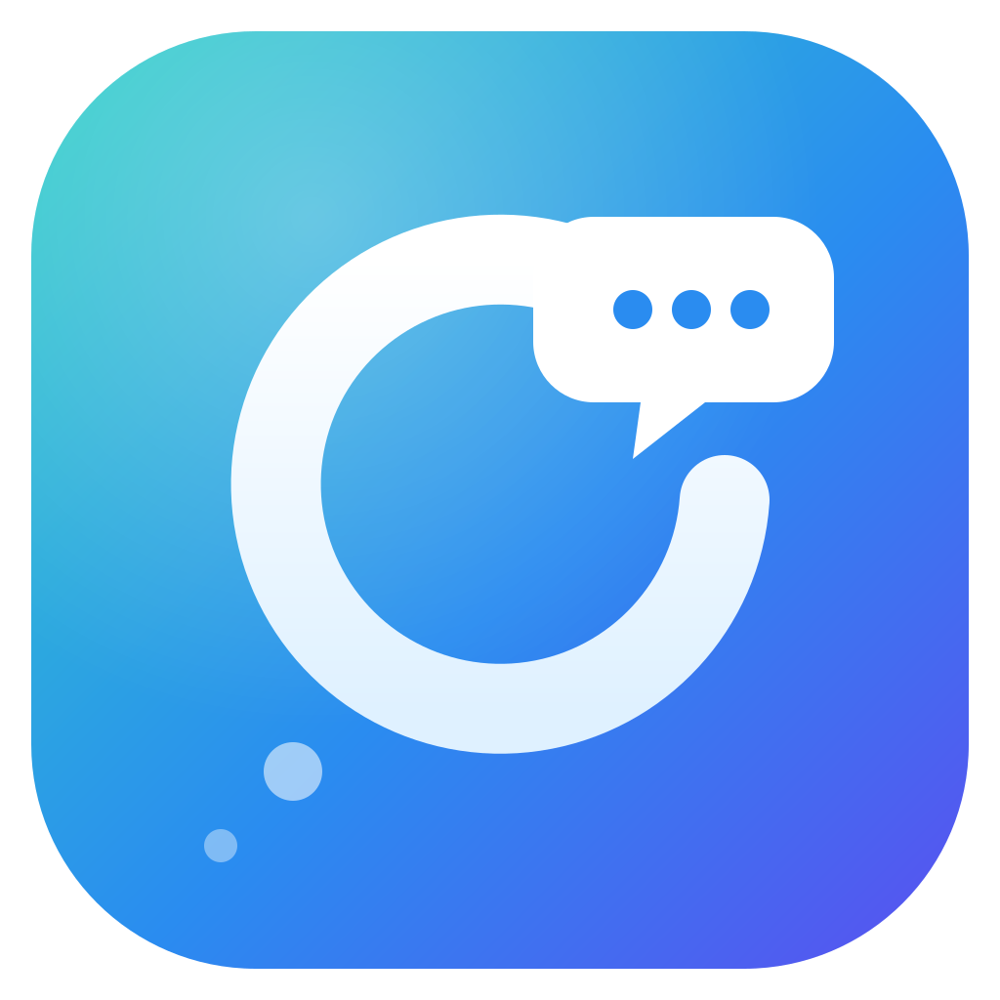
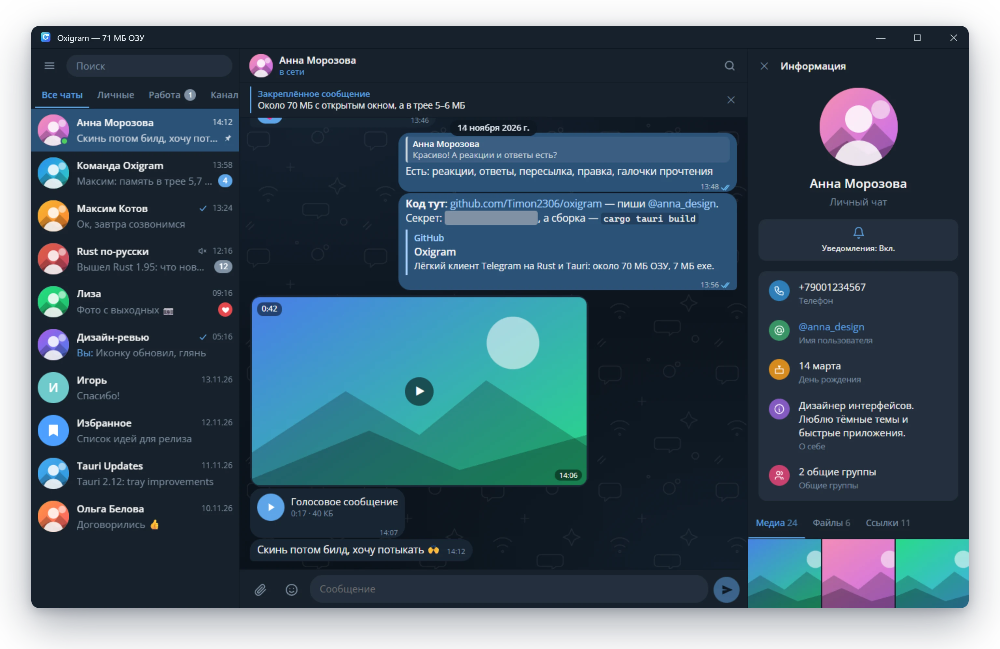
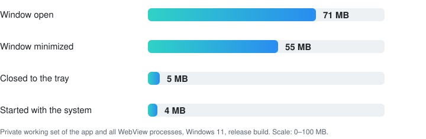
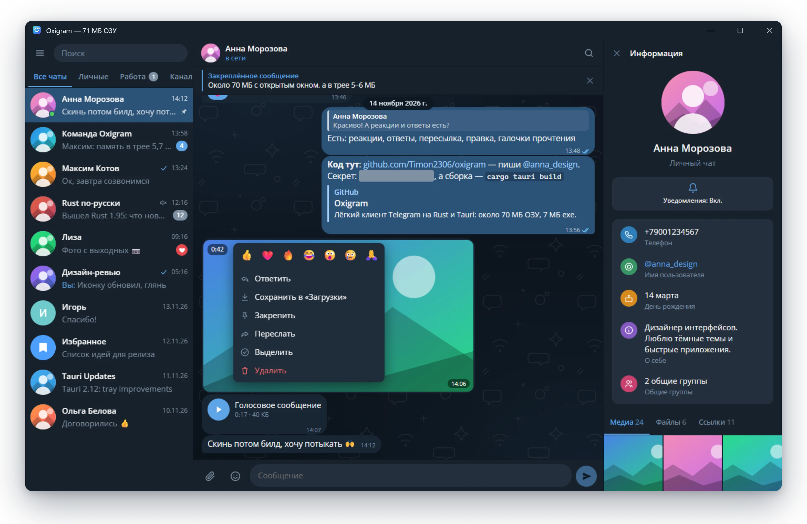
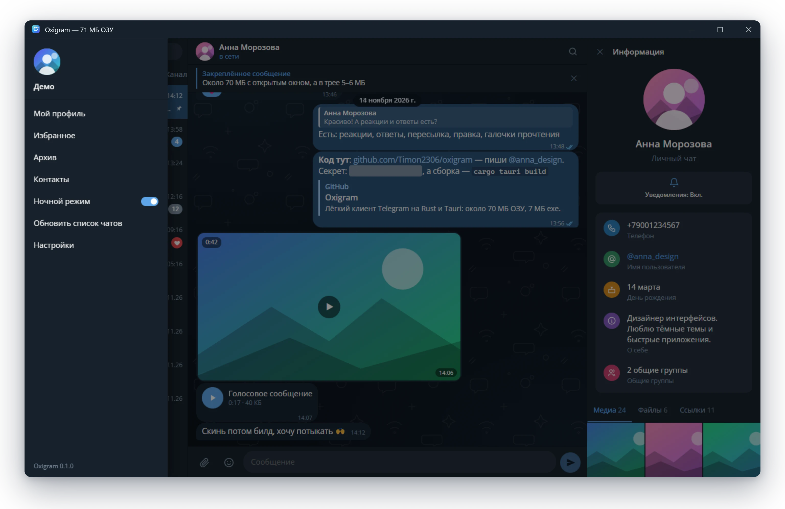
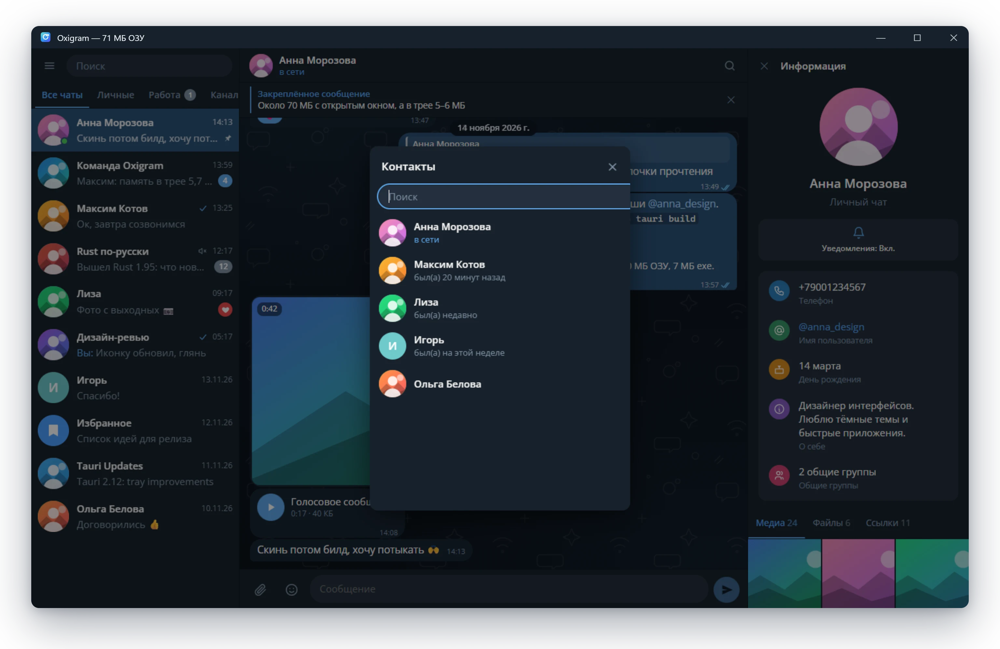

<div align="center">



# Oxigram

**A Telegram desktop client that fits in 70 MB of RAM.**<br>
Rust talks MTProto directly, the window is the system WebView. No TDLib, no Electron, no Qt.

[](LICENSE) [](https://codeberg.org/Lonami/grammers) [](https://tauri.app) [](https://svelte.dev) [](#build-from-source)

**English** · [Русский](README.ru.md)

<br>

<picture>
  <source media="(prefers-color-scheme: light)" srcset="docs/screenshots/light.webp">
  
</picture>

</div>

## Why

Official desktop clients keep a lot in memory: a big media cache, a whole UI
toolkit, sometimes a bundled browser. Oxigram keeps only what is on screen.
The network and the database live in a small Rust process; the interface is a
plain Svelte page drawn by the WebView your OS already has. Close the window
and the WebView is destroyed: Oxigram keeps receiving messages from the tray
for about 5 MB.

<div align="center">
  
</div>

The executable is about 7 MB. The live figure is always in the window title.

## Features

<table>
<tr>
<td width="50%" valign="top">

**💬 Chats**
- Chat folders as tabs, Archive, pinned chats
- Search across chats and inside one (Ctrl+F)
- Mute, mark read/unread, archive, clear, leave
- Drafts per chat, contacts
- Resizable list, down to avatars only

</td>
<td width="50%" valign="top">

**✉️ Messages**
- Formatting: bold, italic, code, spoilers, quotes
- Type `**bold**`, `__italic__`, `||spoiler||` to format
- Replies, editing, forwarding, deleting, pinning
- Reactions, read ticks, "typing…" status
- Multi-select, an "unread messages" divider

</td>
</tr>
<tr>
<td valign="top">

**🖼️ Media**
- Photos, albums, video, voice and audio
- GIFs and video stickers loop while on screen
- Send files by button, Ctrl+V or drag and drop
- Parallel downloads with a progress ring
- Cache capped at 500 MB, clearable in Settings

</td>
<td valign="top">

**🖥️ Desktop**
- Notifications that respect muted chats
- Tray mode and start with the system
- Docked profile column on wide windows
- Light and dark themes, text size
- Keyboard first: Ctrl+Tab, ↑ to edit, Esc

</td>
</tr>
</table>

<div align="center">
<table>
<tr>
<td></td>
<td></td>
</tr>
<tr>
<td></td>
<td></td>
</tr>
</table>
</div>

**Not yet:** animated (Lottie) stickers, calls, stories, several accounts,
recording voice messages, secret chats.

## Getting started

Oxigram ships **without** an `api_id` / `api_hash`; you bring your own.

1. Sign in at <https://my.telegram.org> → **API development tools**.
2. Create an application (any name) and copy `api_id` and `api_hash`.
3. Start Oxigram, paste them, sign in with your phone number.

The keys and the session are stored only on your computer and are sent nowhere
except Telegram's servers.

## Build from source

You need [Rust](https://rustup.rs), Node.js 22+ and the
[Tauri prerequisites](https://tauri.app/start/prerequisites/) for your OS.

```sh
git clone https://github.com/Timon2306/oxigram
cd oxigram
npm install
npm run tauri dev      # run with hot reload
npm run tauri build    # release build
```

**Native window (experimental, work in progress).** The same backend with a
[Slint](https://slint.dev) window instead of a WebView: no Node.js, no WebView2.

```sh
cargo run --release -p oxigram-native
```

<details>
<summary><b>Checks, demo mode and project layout</b></summary>

<br>

```sh
npm run check                            # Svelte / TypeScript
cargo test                               # unit tests (core + Tauri app)
cargo test -- --ignored                  # also talks to Telegram's servers
```

**Demo mode** shows the real interface on made-up chats, for screenshots and
recordings without an account: run `npm run dev` and open
<http://localhost:1420/demo/>. `?scene=chat|context|menu|light|contacts|typing|list`
picks what is shown. It is not part of the app build.

```
src/                 Svelte 5 frontend (no SvelteKit, no UI kit)
demo/                demo mode: the interface on made-up data
core/src/            the backend, shared by both windows (no Tauri inside)
  tg.rs              connection lifecycle and login state machine
  chats.rs           dialogs, history, profiles, folders, media downloads
  actions.rs         menus: pin, archive, react, edit, forward, delete,
                     send files, search, contacts
  updates.rs         live updates, notifications, the event stream
  markup.rs          **bold** / __italic__ shortcuts to message entities
  media.rs           what an attachment is and which thumbnail to fetch
  store/             local SQLite: the session and the chat cache
  mem.rs             process-tree memory measurement (window title)
src-tauri/src/       the Tauri app: IPC commands, tray, WebView tuning
  tray.rs            tray icon; closing the window destroys the WebView
  webview.rs         low WebView2 memory target while minimized
native/              the native Slint window (ui/app.slint + src/main.rs)
```

</details>

## Playing fair

Oxigram is an unofficial client built on the Telegram API and is not
affiliated with Telegram. It follows the
[API Terms of Service](https://core.telegram.org/api/terms): no "ghost mode",
no hidden read receipts or typing status, no keeping of deleted or
self-destructing messages.

## License

[MIT](LICENSE) © Timon2306

Use, change and share Oxigram freely, including in your own projects. The one
condition: keep the copyright notice from [LICENSE](LICENSE), crediting
Timon2306, in every copy and every project based on this code.
