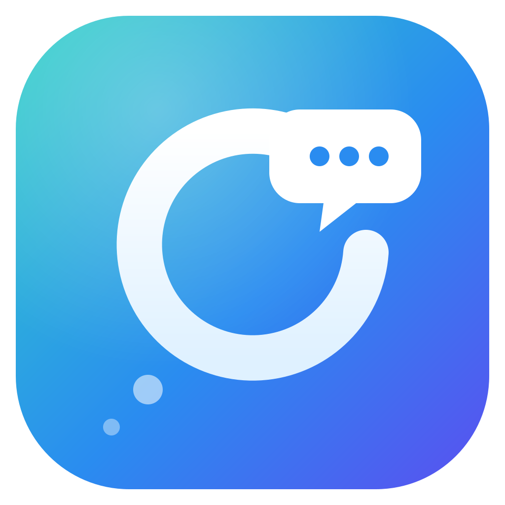
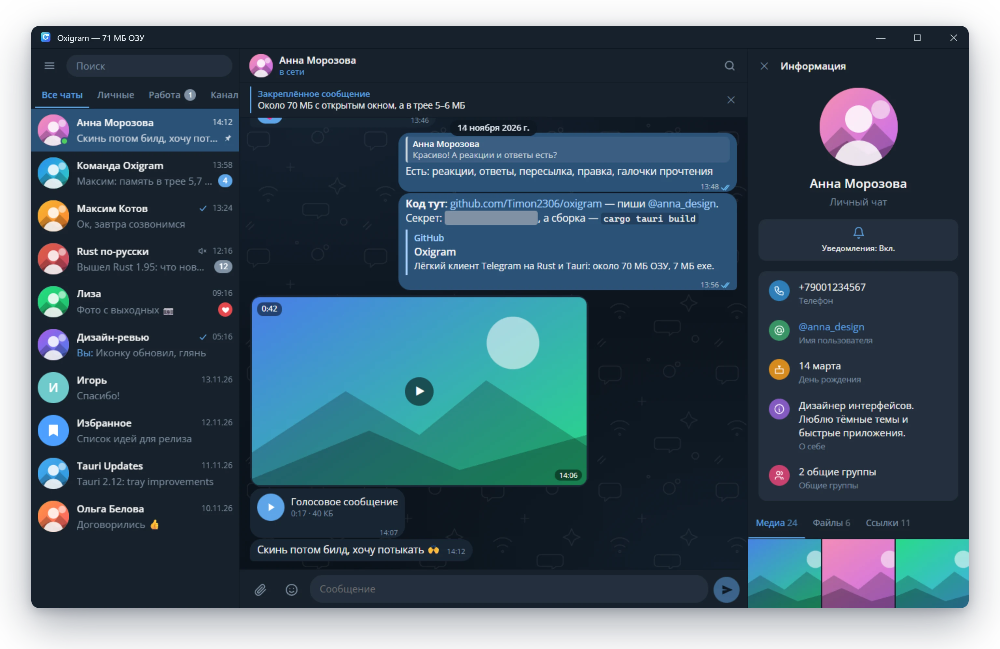
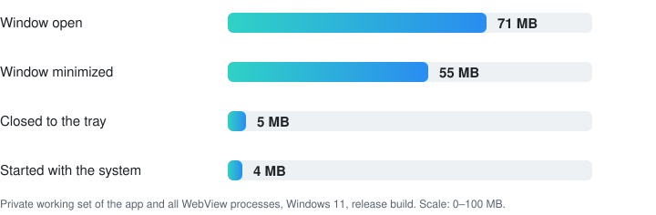
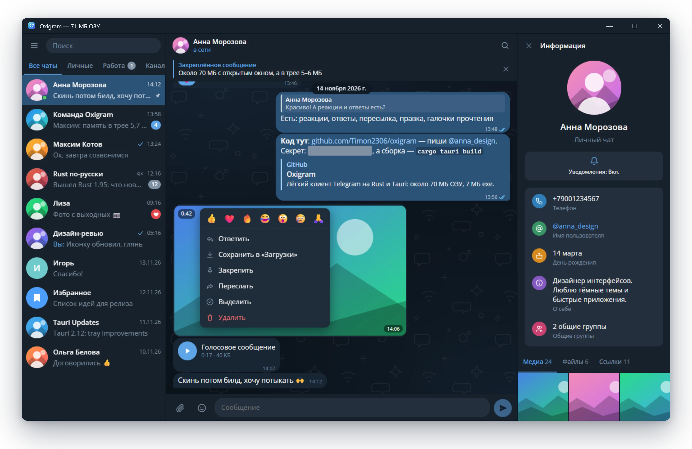
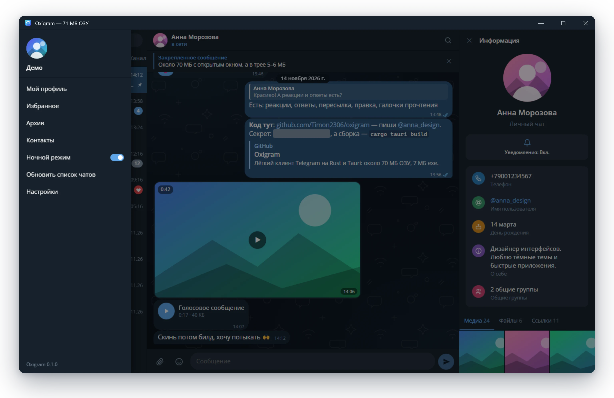
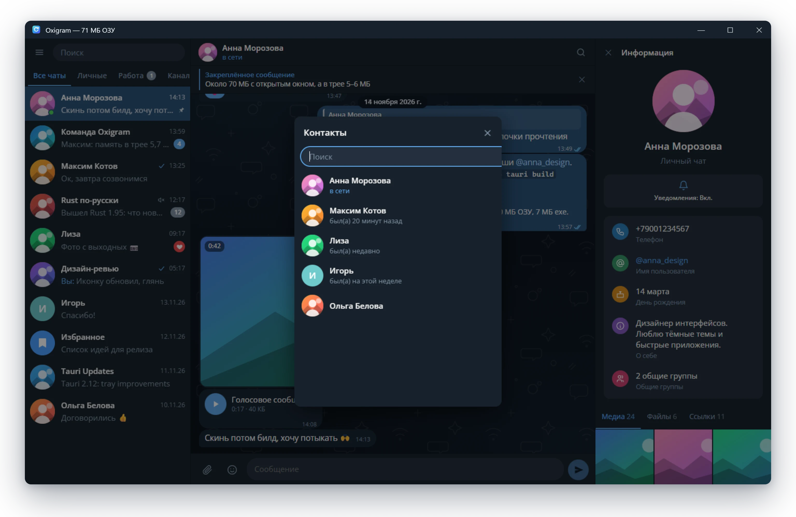

<div align="center">



# Oxigram

**Клиент Telegram для компьютера, которому хватает 70 МБ памяти.**<br>
Rust напрямую говорит по MTProto, окно рисует системный WebView. Без TDLib, Electron и Qt.

[](LICENSE) [](https://codeberg.org/Lonami/grammers) [](https://tauri.app) [](https://svelte.dev) [](#сборка-из-исходников)

[English](README.md) · **Русский**

<br>

<picture>
  <source media="(prefers-color-scheme: light)" srcset="docs/screenshots/light.webp">
  
</picture>

</div>

## Зачем

Официальные клиенты держат в памяти много всего: большой кэш медиа, целый
набор UI-библиотек, иногда встроенный браузер. Oxigram держит только то, что
на экране. Сеть и база данных живут в маленьком процессе на Rust, интерфейс —
обычная страница на Svelte, которую рисует уже установленный в системе WebView.
Закрываешь окно — WebView уничтожается, а Oxigram продолжает получать
сообщения из трея примерно за 5 МБ.

<div align="center">
  
</div>

Исполняемый файл весит около 7 МБ. Текущее потребление всегда видно в заголовке окна.

## Возможности

<table>
<tr>
<td width="50%" valign="top">

**💬 Чаты**
- Папки вкладками, архив, закреплённые чаты
- Поиск по всем чатам и внутри чата (Ctrl+F)
- Без звука, прочитано/непрочитано, архив, очистка, выход
- Черновики для каждого чата, контакты
- Список меняет ширину, вплоть до одних аватарок

</td>
<td width="50%" valign="top">

**✉️ Сообщения**
- Форматирование: жирный, курсив, код, спойлеры, цитаты
- Пиши `**жирный**`, `__курсив__`, `||спойлер||`
- Ответы, правка, пересылка, удаление, закрепление
- Реакции, галочки прочтения, «печатает…»
- Выделение нескольких, разделитель «Непрочитанные»

</td>
</tr>
<tr>
<td valign="top">

**🖼️ Медиа**
- Фото, альбомы, видео, голосовые и аудио
- GIF и видеостикеры крутятся, пока видны
- Отправка файлов кнопкой, Ctrl+V или перетаскиванием
- Параллельная загрузка с кольцом прогресса
- Кэш не больше 500 МБ, чистится в настройках

</td>
<td valign="top">

**🖥️ Компьютер**
- Уведомления с учётом заглушённых чатов
- Работа из трея и автозапуск с системой
- Колонка профиля на широком окне
- Светлая и тёмная темы, размер текста
- Горячие клавиши: Ctrl+Tab, ↑ для правки, Esc

</td>
</tr>
</table>

<div align="center">
<table>
<tr>
<td></td>
<td></td>
</tr>
<tr>
<td></td>
<td></td>
</tr>
</table>
</div>

**Пока нет:** анимированных стикеров (Lottie), звонков, историй, нескольких
аккаунтов, записи голосовых, секретных чатов.

## Как начать

Oxigram поставляется **без** `api_id` / `api_hash`, нужны свои.

1. Войди на <https://my.telegram.org> → **API development tools**.
2. Создай приложение (название любое) и скопируй `api_id` и `api_hash`.
3. Запусти Oxigram, вставь их и войди по номеру телефона.

Ключи и сессия хранятся только на твоём компьютере и не уходят никуда, кроме
серверов Telegram.

## Сборка из исходников

Нужны [Rust](https://rustup.rs), Node.js 22+ и
[зависимости Tauri](https://tauri.app/start/prerequisites/) для твоей ОС.

```sh
git clone https://github.com/Timon2306/oxigram
cd oxigram
npm install
npm run tauri dev      # запуск с горячей перезагрузкой
npm run tauri build    # релизная сборка
```

<details>
<summary><b>Проверки, демо-режим и устройство проекта</b></summary>

<br>

```sh
npm run check                            # Svelte / TypeScript
cd src-tauri && cargo test               # юнит-тесты
cd src-tauri && cargo test -- --ignored  # плюс тесты с серверами Telegram
```

**Демо-режим** показывает настоящий интерфейс на выдуманных чатах — для
скриншотов и записей без аккаунта: запусти `npm run dev` и открой
<http://localhost:1420/demo/>. Параметр `?scene=chat|context|menu|light|contacts|typing|list`
выбирает сцену. В сборку приложения демо не входит.

Устройство проекта описано в [английском README](README.md#build-from-source).

</details>

## Честная игра

Oxigram — неофициальный клиент на Telegram API, не связанный с Telegram.
Он соблюдает [условия использования API](https://core.telegram.org/api/terms):
никакого «режима призрака», скрытого прочтения или статуса набора, никакого
сохранения удалённых и самоуничтожающихся сообщений.

## Лицензия

[MIT](LICENSE) © Timon2306

Oxigram можно свободно использовать, менять и распространять, в том числе в своих
проектах. Условие одно: в каждой копии и каждом проекте на основе этого кода нужно
сохранить уведомление об авторских правах из [LICENSE](LICENSE) с указанием автора — Timon2306.
